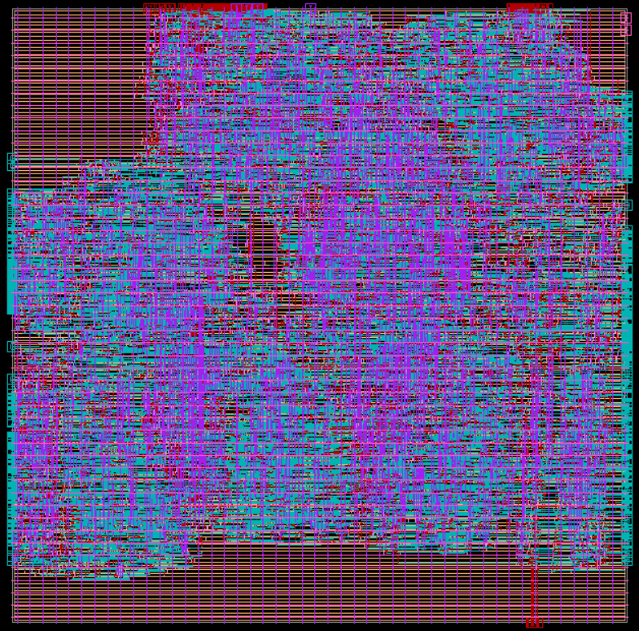
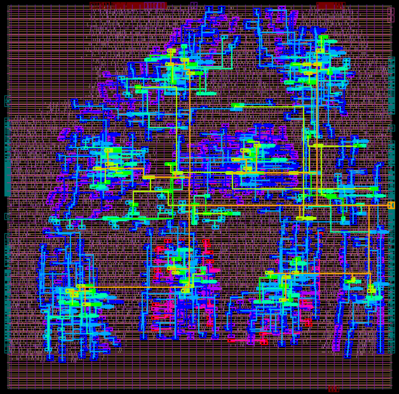

# RTL-to-GDS Physical Design: Sorting Processor on SKY130

Full synthesis and place-and-route flow for `sort_proc`, a multi-module sorting processor (~8.6k standard cells, 1,131 flip-flops), taken from Verilog RTL to a detail-routed, DRC-clean layout on the SkyWater SKY130 open PDK using Synopsys Design Compiler and IC Compiler II.

The goal was to minimize a combined cost metric, **Area³ × Delay (A³D)**, while keeping positive hold margin and zero routing violations.

## Flow

```
RTL ──► Design Compiler ──► init_design ──► place_opt ──► clock_opt (CTS) ──► clock_opt (opto) ──► route_auto ──► route_opt
        (synthesis, DFT)    (floorplan)                   (clock tree)       (post-CTS opt)                    (signoff reports)
```

A single `make` runs synthesis and every ICC2 stage, then `parse_reports.py` scrapes the route_opt QoR, timing, power and per-layer wirelength reports and appends one row to `results/results.csv`. `set_constraints.py` injects the sweep knobs into the SDC and ICC2 setup before each run:

| Knob | Makefile variable | Where it lands |
|------|------------------|----------------|
| Clock period | `CLK_PER` | SDC constraints |
| Core utilization | `UTIL` | floorplan |
| Top routing layer | `MAXLYR` | ICC2 common setup |
| Max transition | `MAXTRANS` | place_opt / CTS |
| Hold clock uncertainty | `CLKUNCERT` | clock_opt |

## Design space exploration

29 runs were logged in `results/results.csv`, sweeping clock period (1.0 to 5.5 ns), utilization (0.5 to 0.98), top metal (Metal3 to Metal5) and transition / uncertainty targets.

| | First run | Final design |
|---|---|---|
| Clock period | 5.5 ns | 1.3 ns |
| Core utilization (set / achieved) | 0.50 / 61.8% | 0.98 / 97.1% |
| Routing layers | Metal1 to Metal5 | Metal1 to Metal4 |
| Cell area | 268,328 µm² | **219,981 µm²** (18% smaller) |
| Total wirelength | 368,212 µm | 325,403 µm |
| Worst hold slack | +0.13 ns | +0.03 ns, 0 hold violations |
| Routing DRC violations | 0 | **0** |
| A³D metric | 1.99e17 | **1.11e17** (44% lower) |

Observations from the sweep:
- Pushing utilization from 0.5 to 0.98 gave the biggest area win; the design still routed cleanly on four layers.
- Dropping to Metal3 as the top layer created congestion (24 DRCs, negative hold slack in one run), so Metal4 was the sweet spot.
- Tightening the clock period mostly traded area for delay; the metric's cubic area term favored a dense floorplan over a very fast clock.

## Clock tree

Built with ICC2 CTS: 1,131 sinks, 4 levels, 42 clock repeaters, 0 transition or capacitance DRCs on the clock network (`results/route_opt.report_clock_qor.summary`).

| Final routed layout | Clock tree |
|---|---|
|  |  |

## Repository layout

```
flow/          Makefile, set_constraints.py, parse_reports.py
constraints/   SDC template and DFT signal definitions
results/       results.csv (every iteration), final QoR and clock QoR reports
images/        final layout and clock tree screenshots
```

The flow is built on the Synopsys DC and ICC2 reference methodology scripts adapted for SKY130; the RTL of the sorting processor is third-party and not included here.

## Tools

Synopsys Design Compiler X-2025.06-SP1 · IC Compiler II W-2024.09-SP2 · SkyWater SKY130 PDK · Python · Make
